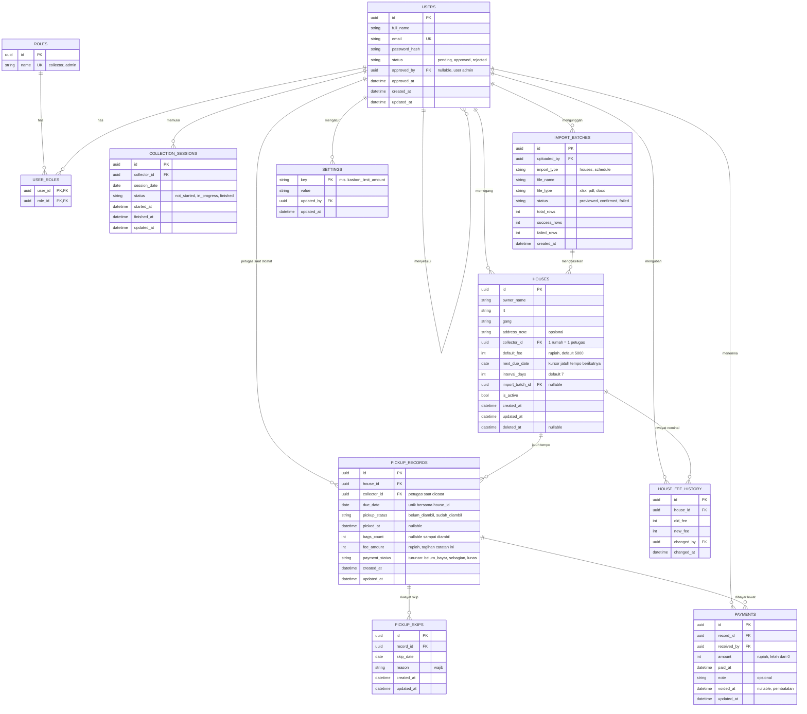

# ERD Final v1.0 — Aplikasi Pemungutan Sampah (Kontz / Bersihku)

> Sumber keputusan: `planning-aplikasi-sampah.md` (v7).
> **Netral tech stack.** Tipe data bersifat generik (uuid, string, int, date, datetime, bool); pemetaan ke DBMS ditentukan setelah stack dipilih.
> 💡 = usulan saya yang perlu disetujui. ⚠️ = belum diputuskan.

## 1. Diagram

## 2. Kamus Data

Kolom "Wajib" = NOT NULL. Semua `id` berupa UUID yang dibuat di perangkat (kebutuhan offline).

### 2.1 ROLES
| Kolom | Tipe | Wajib | Keterangan |
|---|---|---|---|
| id | uuid | ya | PK |
| name | string | ya | unik. Nilai awal: `collector`, `admin` |

### 2.2 USERS
| Kolom | Tipe | Wajib | Keterangan |
|---|---|---|---|
| id | uuid | ya | PK |
| full_name | string | ya | dari layar Registration |
| email | string | ya | unik (💡 tanpa membedakan huruf besar/kecil) |
| password_hash | string | ya | hanya hash, bukan password |
| status | string | ya | `pending` (default), `approved`, `rejected` |
| approved_by | uuid | tidak | FK → USERS (admin yang memutuskan) |
| approved_at | datetime | tidak | terisi saat disetujui/ditolak |
| created_at, updated_at | datetime | ya | |

Aturan: hanya `approved` yang boleh login. Perpindahan status: `pending → approved` atau `pending → rejected`.

### 2.3 USER_ROLES
| Kolom | Tipe | Wajib | Keterangan |
|---|---|---|---|
| user_id | uuid | ya | PK gabungan, FK → USERS |
| role_id | uuid | ya | PK gabungan, FK → ROLES |

Pendaftar baru otomatis mendapat role `collector`. Role `admin` diberikan oleh admin. Satu user boleh punya dua role.

### 2.4 HOUSES
| Kolom | Tipe | Wajib | Keterangan |
|---|---|---|---|
| id | uuid | ya | PK |
| owner_name | string | ya | nama pemilik (tampil di kartu) |
| rt | string | ya | |
| gang | string | ya | |
| address_note | string | tidak | catatan alamat tambahan |
| collector_id | uuid | ya | FK → USERS. **1 rumah hanya 1 petugas**; 1 petugas boleh banyak rumah. Hanya admin yang mengubahnya |
| default_fee | int | ya | rupiah, default 5000, ≥ 0 |
| next_due_date | date | tidak | kursor: tanggal jatuh tempo berikutnya yang **belum dibuatkan catatannya**. Kosong = rumah belum berjadwal |
| interval_days | int | ya | default 7, ≥ 1 |
| import_batch_id | uuid | tidak | FK → IMPORT_BATCHES |
| is_active | bool | ya | default true; nonaktif = tidak dibuatkan catatan baru |
| created_at, updated_at | datetime | ya | |
| deleted_at | datetime | tidak | penghapusan lunak |

### 2.5 COLLECTION_SESSIONS
| Kolom | Tipe | Wajib | Keterangan |
|---|---|---|---|
| id | uuid | ya | PK |
| collector_id | uuid | ya | FK → USERS |
| session_date | date | ya | unik bersama collector_id |
| status | string | ya | `not_started`, `in_progress`, `finished` |
| started_at / finished_at | datetime | tidak | terisi saat "Mulai Ambil Sampah" / selesai |
| updated_at | datetime | ya | |

Hanya menandai petugas sudah memulai hari itu; tidak memiliki record. ⚠️ Cara sesi ditutup (manual atau otomatis) belum didesain.

### 2.6 PICKUP_RECORDS
Satu baris = satu **kemunculan jatuh tempo** sebuah rumah.
| Kolom | Tipe | Wajib | Keterangan |
|---|---|---|---|
| id | uuid | ya | PK |
| house_id | uuid | ya | FK → HOUSES |
| collector_id | uuid | ya | FK → USERS. Petugas yang bertanggung jawab saat dicatat (ikut berubah bila admin memindahkan rumah dan catatan masih terbuka) |
| due_date | date | ya | tanggal jatuh tempo menurut jadwal; **unik bersama house_id** |
| pickup_status | string | ya | `belum_diambil` (default), `sudah_diambil`. "Skip" bukan status, lihat PICKUP_SKIPS |
| picked_at | datetime | tidak | wajib terisi jika `sudah_diambil` |
| bags_count | int | tidak | jumlah karung; wajib terisi jika `sudah_diambil`, ≥ 0 (⚠️ apakah minimal 1?) |
| fee_amount | int | ya | rupiah, tagihan; salinan `default_fee` saat dibuat |
| payment_status | string | ya | **turunan** dari pembayaran (cache): `belum_bayar`, `sebagian`, `lunas` |
| created_at, updated_at | datetime | ya | |

### 2.7 PICKUP_SKIPS
| Kolom | Tipe | Wajib | Keterangan |
|---|---|---|---|
| id | uuid | ya | PK |
| record_id | uuid | ya | FK → PICKUP_RECORDS |
| skip_date | date | ya | unik bersama record_id (satu skip per catatan per hari) |
| reason | string | ya | **wajib**, tidak boleh kosong; boleh diubah |
| created_at, updated_at | datetime | ya | |

⚠️ Jika alasan skip nanti berupa pilihan baku, perlu tabel/daftar nilai alasan.

### 2.8 PAYMENTS
Append-only: setiap uang masuk = satu baris.
| Kolom | Tipe | Wajib | Keterangan |
|---|---|---|---|
| id | uuid | ya | PK |
| record_id | uuid | ya | FK → PICKUP_RECORDS (catatan yang dilunasi, dipilih petugas) |
| received_by | uuid | ya | FK → USERS |
| amount | int | ya | rupiah, > 0; dibatasi sebesar sisa catatan |
| paid_at | datetime | ya | dasar perhitungan kartu Uang |
| note | string | tidak | |
| voided_at | datetime | tidak | terisi bila dibatalkan; pembayaran batal tidak dihitung |
| updated_at | datetime | ya | berubah saat dibatalkan, agar terdeteksi sinkronisasi |

### 2.9 HOUSE_FEE_HISTORY
| Kolom | Tipe | Wajib | Keterangan |
|---|---|---|---|
| id | uuid | ya | PK |
| house_id | uuid | ya | FK → HOUSES |
| old_fee, new_fee | int | ya | rupiah |
| changed_by | uuid | ya | FK → USERS |
| changed_at | datetime | ya | |

Satu baris setiap `default_fee` berubah. Catatan yang sudah diambil tidak ikut berubah.

### 2.10 SETTINGS
| Kolom | Tipe | Wajib | Keterangan |
|---|---|---|---|
| key | string | ya | PK. Saat ini: `kasbon_limit_amount` |
| value | string | ya | nilai (rupiah bulat untuk batas kasbon, ≥ 0) |
| updated_by | uuid | ya | FK → USERS (admin) |
| updated_at | datetime | ya | |

Batas kasbon: satu nilai global untuk semua rumah. ⚠️ Nilai awalnya belum ditentukan.

### 2.11 IMPORT_BATCHES
| Kolom | Tipe | Wajib | Keterangan |
|---|---|---|---|
| id | uuid | ya | PK |
| uploaded_by | uuid | ya | FK → USERS |
| import_type | string | ya | `houses` atau `schedule` |
| file_name | string | ya | |
| file_type | string | ya | `xlsx`, `pdf`, `docx` |
| status | string | ya | `previewed`, `confirmed`, `failed` |
| total_rows, success_rows, failed_rows | int | ya | |
| created_at | datetime | ya | |

⚠️ Kolom file sumber belum diketahui; `HOUSES` mungkin bertambah kolom opsional (mis. nomor telepon) setelah ada contoh file.

## 3. Constraint dan Indeks

### Keunikan
| Tabel | Unik pada |
|---|---|
| USERS | email |
| ROLES | name |
| USER_ROLES | (user_id, role_id) |
| PICKUP_RECORDS | (house_id, due_date) |
| PICKUP_SKIPS | (record_id, skip_date) |
| COLLECTION_SESSIONS | (collector_id, session_date) |

### Aturan nilai
- `houses.default_fee ≥ 0`, `houses.interval_days ≥ 1`.
- `pickup_records`: `picked_at` dan `bags_count` terisi **jika dan hanya jika** `pickup_status = sudah_diambil`; `fee_amount ≥ 0`.
- `pickup_skips.reason` tidak kosong setelah dipangkas spasi.
- `payments.amount > 0`; jumlah pembayaran aktif (tanpa `voided_at`) pada satu catatan **tidak boleh melebihi** `fee_amount`; pembayaran hanya untuk catatan `sudah_diambil`.
- `houses.collector_id` harus user `approved` ber-role `collector` (dijaga di lapisan aplikasi).
- Semua FK **RESTRICT** (tanpa cascade delete). Penghapusan memakai `deleted_at`.

### Indeks yang disarankan
| Tabel | Indeks | Untuk |
|---|---|---|
| HOUSES | (collector_id, is_active) | daftar rumah petugas |
| HOUSES | (collector_id, next_due_date) | pembuatan catatan saat "Mulai Ambil Sampah" |
| PICKUP_RECORDS | (collector_id, pickup_status, due_date) | Daftar Rumah, progres, terbawa |
| PICKUP_RECORDS | (collector_id, picked_at) | kartu Karung + filter rentang |
| PICKUP_RECORDS | (house_id, pickup_status) | kasbon per rumah |
| PAYMENTS | (record_id) | total terbayar per catatan |
| PAYMENTS | (received_by, paid_at) | kartu Uang + filter rentang |
| USERS | (status) | daftar pendaftar pending |
| Semua tabel tersinkron | (updated_at) | tarik perubahan saat sinkronisasi |

## 4. Rumus Turunan (tidak disimpan kecuali tertulis)

| Nilai | Rumus |
|---|---|
| Total terbayar catatan | Σ `payments.amount` dengan `voided_at` kosong |
| Sisa catatan | `fee_amount − total terbayar` (hanya catatan sudah diambil) |
| `payment_status` | total = 0 → `belum_bayar`; 0 < total < fee → `sebagian`; total = fee → `lunas` |
| Kasbon rumah | Σ sisa semua catatan sudah diambil milik rumah itu |
| Peringatan kasbon | kasbon rumah > `kasbon_limit_amount` (hanya peringatan) |
| Terbawa | `due_date` < hari ini **dan** `pickup_status = belum_diambil` |
| Status kartu | sudah diambil → ikut `payment_status` (hijau / kuning / merah); belum diambil dan ada skip hari ini → **Skip** (merah nuansa berbeda); selain itu abu-abu |
| Progres Beranda | diambil hari ini ÷ (diambil hari ini + belum diambil di daftar hari ini); skip bukan selesai |
| Kartu Karung | Σ `bags_count` dengan `picked_at` dalam rentang |
| Kartu Uang | Σ `payments.amount` aktif dengan `paid_at` dalam rentang |
| Rentang | Hari ini; Mingguan = Senin–Minggu berjalan; Bulanan = bulan kalender berjalan 💡 |
| Pembuatan catatan | untuk tiap rumah aktif dengan `next_due_date ≤ hari ini`: buat catatan (house_id, due_date = next_due_date), lalu `next_due_date += interval_days`, ulangi sampai melewati hari ini |

`payment_status` disimpan sebagai cache dan **dihitung ulang setiap pembayaran berubah**; sumber kebenarannya tetap tabel `PAYMENTS`.

## 5. Perubahan Skema Saat Pengubahan

| Kejadian | Efek pada data |
|---|---|
| Petugas mengubah nominal rumah | `default_fee` berubah; `fee_amount` catatan rumah itu yang **belum diambil** ikut berubah; baris baru di `HOUSE_FEE_HISTORY`; catatan sudah diambil tetap |
| Rumah diambil | `pickup_status = sudah_diambil`, `picked_at`, `bags_count`; kursor jadwal **tidak** bergeser |
| Skip | baris baru/ubah di `PICKUP_SKIPS` untuk hari itu; catatan tetap terbuka dan muncul lagi besok |
| Pembayaran | baris baru di `PAYMENTS`; `payment_status` dihitung ulang |
| Koreksi pembayaran | `voided_at` diisi (baris tidak dihapus); `payment_status` dihitung ulang |
| Admin memindahkan rumah | `houses.collector_id` berubah; `collector_id` pada catatan **terbuka** ikut pindah; catatan sudah diambil tetap atas nama petugas lama |
| Persetujuan admin | `users.status`, `approved_by`, `approved_at` |

## 6. Aturan Sinkronisasi (offline)

- ID dibuat di perangkat; identitas catatan pengambilan adalah **(house_id, due_date)** sehingga pembuatan ganda tidak menghasilkan duplikat.
- Setiap tabel tersinkron punya `updated_at`; baris yang dihapus ditandai `deleted_at`.
- `PAYMENTS` bersifat tambah-saja; pembatalan memperbarui `voided_at` + `updated_at`.
- Server memeriksa ulang batas "total pembayaran ≤ fee_amount" saat menerima data; pelanggaran ditandai konflik.
- Metadata sinkronisasi (`sync_status`, antrean perubahan) **hanya ada di perangkat**, tidak masuk skema server.
- Bentrok yang tersisa diselesaikan dengan 💡 `updated_at` terbaru berlaku; pemindahan rumah oleh admin saat petugas offline diberi pemberitahuan.

## 7. Sengaja Tidak Dimasukkan

- Kategori/berat sampah, foto bukti, laporan kendala (tidak ada di desain).
- Akun warga/pemilik rumah (pemilik hanya data pada rumah).
- Tabel penugasan banyak petugas per rumah (diputuskan 1 rumah 1 petugas).
- Riwayat pemindahan rumah (💡 opsional nanti: tabel riwayat kepemilikan bila perlu audit).
- Rincian galat per baris import (saat ini hanya jumlah gagal).
- Notifikasi dan log audit umum.

## 8. Asumsi yang Perlu Disetujui (💡)

1. **Rupiah disimpan sebagai bilangan bulat** (tanpa desimal), karena iuran Rp5.000 dan tidak ada sen.
2. **Waktu:** `datetime` disimpan dalam UTC; semua `date` bisnis (due_date, skip_date, session_date, batas rentang mingguan/bulanan) memakai **zona waktu lokal petugas** (WIB).
3. **`payment_status` disimpan sebagai cache turunan** (bukan sumber kebenaran).
4. **Email unik tanpa membedakan huruf besar/kecil.**
5. **Semua FK RESTRICT**; penghapusan hanya lunak.
6. **`bags_count` boleh 0** (⚠️ atau minimal 1?).

## 9. Hal Terbuka yang Bisa Menambah Kolom

| Hal | Dampak pada ERD |
|---|---|
| Contoh file import | kolom opsional baru di `HOUSES` (mis. telepon), aturan pencocokan duplikat |
| Alasan skip baku | tabel/daftar nilai alasan, atau kolom kategori di `PICKUP_SKIPS` |
| Nilai awal batas kasbon | baris awal di `SETTINGS` |
| Cara admin pertama dibuat | data awal (seed) di `USERS` dan `USER_ROLES` |
| Mekanisme lupa password | tabel token reset (jika dipakai) |
| Cara sesi ditutup | perilaku `COLLECTION_SESSIONS.status` |
| Layar ikon navigasi 1, 2, 4 | bergantung fungsinya (mungkin tidak menambah tabel) |

Selain tujuh hal di atas, struktur tabel inti dinyatakan **final**.
