# Planning Aplikasi Pemungutan Sampah (Sisi Petugas)

> **Status: DRAFT v7** — admin diputuskan sebagai role di aplikasi yang sama; ERD difinalkan (lihat `erd-final.md` untuk kamus data lengkap).
> **Tech stack dan eksekusi kode: ditunda.** Diagram netral (tanpa endpoint/framework).
> ⚠️ = belum pasti / perlu dikonfirmasi. 💡 = usulan atau tafsiran saya, bukan keputusan.

## 0. Ringkasan Keputusan

| # | Keputusan |
|---|---|
| 1 | Iuran default **Rp5.000 per rumah**. Petugas bisa mengubah nominal; berlaku **seterusnya sebagai default rumah**, **hanya untuk catatan yang belum diangkut**. Catatan lama dibiarkan, tetapi **perubahan dicatat** |
| 2 | Kartu **Uang** dan **Karung** di Beranda punya filter **Hari ini / Mingguan (Senin–Minggu) / Bulanan**; Karung dihitung dari tanggal pengambilan |
| 3 | Rumah **Skip dihitung belum selesai** dan **ikut terbawa ke hari berikutnya** |
| 4 | **Petugas mengisi data rumah**; rencana **import dari Excel, PDF, DOCX** |
| 5 | **Jadwal pengambilan sesuai jadwal tertentu**; jadwal juga bisa **diimport** dari Excel/PDF/DOCX |
| 6 | Siklus sementara **mingguan mengikuti hari jadwal tetap**: jadwal Senin lalu baru diambil Rabu, berikutnya tetap **Senin depan**. Jika catatan lama belum diambil saat jatuh tempo baru tiba, jadi **dua catatan terpisah** (dua tagihan, dua pembayaran) |
| 7 | **1 petugas memegang banyak rumah; 1 rumah hanya dipegang 1 petugas** |
| 8 | Idealnya **bayar tunai langsung setelah diangkut**; **pembayaran sebagian dan kasbon dicatat** |
| 9 | Saat bayar kasbon, **petugas memilih catatan yang dilunasi**; uang yang melebihi sisa **dibatasi sebesar sisa** |
| 10 | **Ada batas kasbon**: satuan **nominal rupiah**, berlaku **untuk semua rumah**, saat terlampaui **hanya peringatan dulu**; nilainya diubah admin |
| 11 | Warna status: pembayaran **sebagian = kuning**; **Skip = merah dengan nuansa berbeda** dari merah "Belum bayar penuh" |
| 12 | **Admin yang memindahkan rumah** antarpetugas |
| 13 | **Pendaftaran petugas perlu persetujuan admin** |
| 14 | **Skip wajib alasan** dan **bisa diubah** |
| 15 | **Sebisa mungkin offline** |
| 16 | **Ikon navigasi persis seperti Figma**; **label dan layar** ikon 1, 2, 4 belum ada dan akan **dirancang kemudian mengikuti tema UI yang sudah ada** |
| 17 | Tech stack dan eksekusi **nanti** |
| 18 | **Admin adalah role di aplikasi yang sama** (login multi-role), bukan panel terpisah; menu yang tampil mengikuti role |

## 1. Referensi UI

Branding di desain: aplikasi **Kontz**, logo **Bersihku**.

| Layar | Isi yang terlihat di desain |
|---|---|
| **Login** | Email, password, "Forget password?", tombol Login, link "Sign Up" |
| **Registration** | Full name, email, password, confirm password, tombol Register, link "Sign In" |
| **Beranda** | Tanggal, sapaan "Hallo [nama user], Selamat Bertugas Hari Ini", progres (50% — 20 dari 40 rumah), kartu **Karung** (X pcs), kartu **Uang** (Rp.), tombol **Mulai Ambil Sampah** |
| **Daftar Rumah** | Kolom cari, kartu rumah: nama pemilik, RT, gang, status berwarna |
| **Bottom navigation** | 4 ikon di layar utama |

### Status rumah (warna kartu)

| Warna | Status | Sumber |
|---|---|---|
| Abu-abu | Belum diambil | Figma |
| Hijau | Sudah diambil + Sudah bayar (lunas) | Figma |
| Merah (seperti Figma) | Sudah diambil + Belum bayar (kasbon penuh) | Figma |
| Merah (nuansa berbeda) | **Skip** | Keputusan terbaru (di Figma Skip berwarna kuning) |
| Kuning | **Sudah diambil + Bayar sebagian** | Keputusan terbaru |

**Desain Figma perlu diperbarui:** kartu Skip di Daftar Rumah berubah dari kuning ke merah, dan ditambah status baru Sebagian (kuning).

**Dua status merah dibedakan lewat nuansa warna.** "Belum bayar penuh" tetap merah seperti Figma, sedangkan Skip memakai merah dengan nuansa berbeda. Kode warna tepatnya ditentukan saat desain diperbarui. ⚠️ 💡 Selain warna, kartu sebaiknya tetap menampilkan label teks status, supaya tidak keliru dibaca di lapangan (misalnya saat layar terkena sinar matahari).

### Navigasi bawah

Empat ikon: (1) clipboard, (2) dua orang, (3) rumah, (4) kantong uang. Ikon harus identik dengan Figma, sebaiknya asset diekspor langsung dari Figma. **Label dan layar untuk ikon 1, 2, dan 4 belum ada**; akan dirancang kemudian dengan mengikuti tema visual yang sudah ada (lihat di bawah). Ikon 3 (rumah) sudah punya layar: Daftar Rumah (⚠️ dugaan, dari ikon dan isi layar).

### Tema visual yang sudah ada (acuan untuk layar baru)

Hal-hal yang terlihat konsisten di desain saat ini:
- Header **hijau cerah** berbentuk lengkung dengan logo **Bersihku**, di atas latar putih/abu sangat muda.
- Kartu **hijau** dengan sudut membulat untuk ringkasan (progres, Karung, Uang) dan status rumah.
- Tombol aksi utama berbentuk **pil**; layar Login/Registrasi memakai tombol **teal**, kolom isian putih membulat, dan ilustrasi.
- Teks tebal dan ringkas, bottom navigation 4 ikon.

Layar baru (form catat, kasbon, tambah/edit rumah, import, admin, layar ikon 1, 2, 4) sebaiknya memakai elemen-elemen ini agar konsisten. Ini ringkasan visual dari gambar yang dikirim, bukan spesifikasi resmi (kode warna dan font belum diketahui).

### Belum ada desainnya

Form catat pengambilan/pembayaran, pelunasan kasbon, tambah/edit rumah (jadwal, nominal), import data & jadwal, layar ikon 1, 2, 4, lupa password, profil, layar admin (persetujuan, pemindahan rumah, batas kasbon), form alasan skip.

## 2. Lingkup

**Sekarang:** aktor **Petugas** (utama) dan **Admin**. Admin kini memegang: persetujuan pendaftaran, pemindahan rumah, dan pengaturan batas kasbon. Admin memakai **aplikasi yang sama** dengan role `admin`; setelah login, petugas diarahkan ke Beranda dan admin ke menu admin. Layar admin belum didesain.
**Nanti:** peran lain dan fitur admin lebih lengkap. Skema memakai `roles` + `user_roles`.

| Kode | Fitur | Dasar |
|---|---|---|
| F1 | Registrasi (menunggu persetujuan admin) | Layar Registration + #13 |
| F2 | Login / logout | Layar Login |
| F3 | Lupa password | Link di Login (⚠️ layar belum ada) |
| F4 | Beranda: progres, karung, uang + filter | Layar Beranda + #2 |
| F5 | Mulai ambil sampah (rumah jatuh tempo + terbawa) | Tombol Beranda + #3, #5, #6 |
| F6 | Daftar rumah + cari + status | Layar Daftar Rumah |
| F7 | Catat pengambilan & pembayaran (penuh / sebagian / kasbon) | #1, #8, #10 |
| F8 | Skip rumah (alasan wajib, bisa diubah) | #14 |
| F9 | Tambah/edit rumah: data, jadwal, nominal default | #1, #4, #5 |
| F10 | Import data rumah dan jadwal | #4, #5 |
| F11 | Persetujuan pendaftaran oleh admin | #13 |
| F12 | Sinkronisasi data offline | #15 |
| F13 | Pelunasan kasbon (petugas memilih catatan) | #8, #9 |
| F14 | Rekap uang (tab ikon 4) | ⚠️ asumsi, ditunda |
| F15 | Admin memindahkan rumah antarpetugas | #12 |
| F16 | Admin mengatur batas kasbon | #10 |

## 3. Aturan Bisnis

1. **Iuran:** default Rp5.000 (`houses.default_fee`). Mengubah nominal: (a) mengubah default rumah seterusnya, (b) memperbarui `fee_amount` pada catatan rumah itu yang **belum diangkut**, (c) **tidak mengubah** catatan yang sudah diangkut, (d) **mencatat perubahan** di riwayat nominal (siapa, kapan, dari berapa ke berapa).
2. **Kepemilikan rumah:** setiap rumah dipegang tepat **1 petugas** (`houses.collector_id`); 1 petugas boleh memegang **banyak rumah**. Rumah yang dibuat/diimport petugas otomatis miliknya. **Hanya admin yang bisa memindahkan** rumah ke petugas lain.
3. **Jadwal mingguan tetap:** tiap rumah punya tanggal jatuh tempo berulang (`interval_days`, default 7, bisa diubah karena aturan ini "untuk sementara"). Jatuh tempo **tidak bergeser** oleh tanggal ambil: jadwal Senin diambil Rabu, berikutnya tetap Senin depan. Tanggal jadwal pertama diisi manual atau lewat import.
4. **Daftar hari ini** = catatan terbuka (belum diambil) milik petugas dengan `due_date <= hari ini`. Rumah belum diambil dan rumah skip otomatis **terbawa** sampai diambil. Bila jatuh tempo berikutnya tiba saat catatan lama masih terbuka, keduanya tetap **catatan terpisah** (dua tagihan, dua pembayaran) dan keduanya muncul di daftar, catatan lama ditandai terbawa.
5. **Skip:** wajib alasan, berlaku untuk hari itu. Besoknya rumah muncul lagi sebagai terbawa; riwayat skip tetap tersimpan. Alasan hari itu boleh diubah, dan rumah boleh diubah jadi diambil.
6. **Progres Beranda:** `rumah diambil hari ini ÷ (diambil hari ini + belum diambil di daftar hari ini)`. Skip dan terbawa masuk penyebut; **skip bukan selesai**.
7. **Pembayaran:** ideal tunai penuh saat diangkut. Boleh **sebagian** atau **nol (kasbon)**. Tiap uang masuk = satu baris pembayaran. Sisa = `fee_amount − Σ pembayaran`. Pelunasan kemudian (F13): **petugas memilih catatan** yang dilunasi. Uang yang diterima **dibatasi sebesar sisa** catatan terpilih (tidak bisa melebihi sisa).
8. **Batas kasbon:** satu nilai **nominal rupiah** yang **berlaku untuk semua rumah**, diatur dan diubah **admin**. Kasbon rumah = total sisa tagihan semua catatan yang sudah diambil. Saat terlampaui, aplikasi **hanya menampilkan peringatan** (tidak memblokir pengambilan atau pencatatan). 💡 Peringatan muncul saat petugas mencatat pengambilan rumah tersebut. Perilaku bisa diperketat nanti.
9. **Kartu Uang:** total uang yang **diterima** petugas pada rentang (menurut tanggal terima), termasuk pelunasan kasbon lama. **Kartu Karung:** total `bags_count` menurut tanggal pengambilan.
10. **Rentang filter:** Hari ini; **Mingguan = Senin–Minggu** minggu berjalan; Bulanan = bulan kalender berjalan 💡.
11. **Pendaftaran:** akun baru `pending`, tidak bisa login sampai disetujui admin.

## 4. Prinsip Offline (netral stack)

**Perlu online:** registrasi, login pertama, tindakan admin, sinkronisasi.
**Harus bisa offline:** lihat daftar rumah, catat pengambilan/pembayaran/skip, tambah-edit rumah, lihat Beranda.

- ID dibuat di perangkat (UUID); setiap tabel punya `updated_at`; penghapusan memakai `deleted_at`.
- Catatan pengambilan unik per **(house_id, due_date)**, jadi pembuatan offline tidak menghasilkan duplikat.
- **Pembayaran append-only**: tiap setoran baris baru, aman disinkronkan. Koreksi lewat pembatalan (`voided_at`). 💡
- Karena 1 rumah hanya 1 petugas, bentrok antarpetugas jarang terjadi. Bentrok tersisa (satu petugas di dua perangkat, atau admin memindahkan rumah saat petugas offline): 💡 **perubahan terbaru (`updated_at`) berlaku**, dan bentrok pemindahan rumah diberi pemberitahuan. ⚠️
- Perangkat menyimpan antrean perubahan (`sync_status`: pending / synced / conflict).

## 5. Entity Relationship Diagram (FINAL v1.0)

> Kamus data lengkap (kolom, tipe, constraint, indeks, rumus, aturan sinkronisasi) ada di **`erd-final.md`**. Diagram di bawah sama dengan yang di sana.

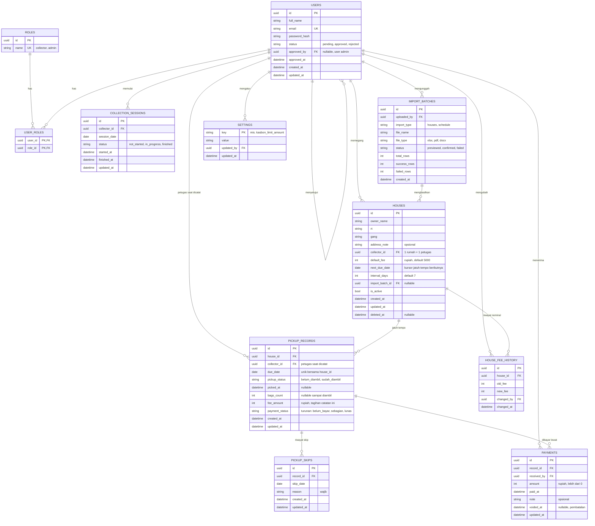

**Ringkasan keputusan skema**
- **Kepemilikan:** `houses.collector_id` satu nilai per rumah (1 rumah 1 petugas); satu petugas bisa memegang banyak rumah. Tidak ada tabel penugasan.
- **Satu `PICKUP_RECORDS` = satu kemunculan jatuh tempo** (house_id + due_date), bertahan lintas hari sampai diambil, sehingga rumah belum diambil dan skip terbawa tanpa mekanisme tambahan. Dua jatuh tempo yang bertumpuk = dua catatan terpisah.
- **Jadwal tetap:** `next_due_date` adalah kursor pembuatan catatan; tanggal ambil tidak menggesernya.
- **Skip** = riwayat per hari (`PICKUP_SKIPS`), bukan status record.
- **Pembayaran** append-only (`PAYMENTS`); `payment_status` turunan; kasbon rumah dihitung.
- **Riwayat nominal** di `HOUSE_FEE_HISTORY`; batas kasbon global di `SETTINGS`.
- Rupiah sebagai bilangan bulat; waktu UTC dengan tanggal bisnis zona lokal (usulan, lihat `erd-final.md` bagian 8).
- Tidak ada tabel kategori/berat, foto, kendala, atau akun warga karena tidak ada di desain.

## 6. Sequence Diagram per Fitur

### F1 — Registrasi

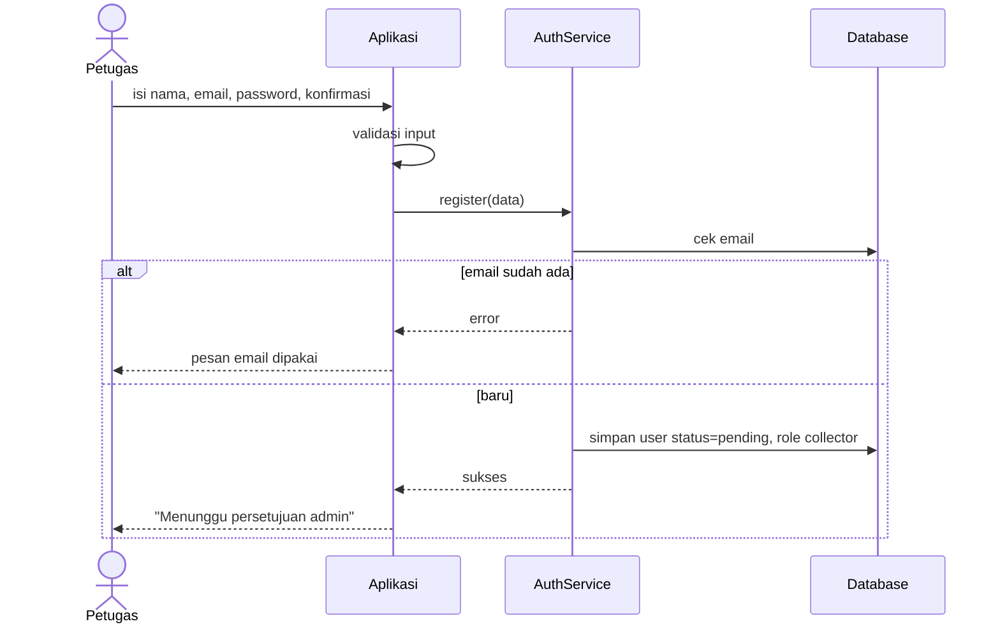

### F2 — Login

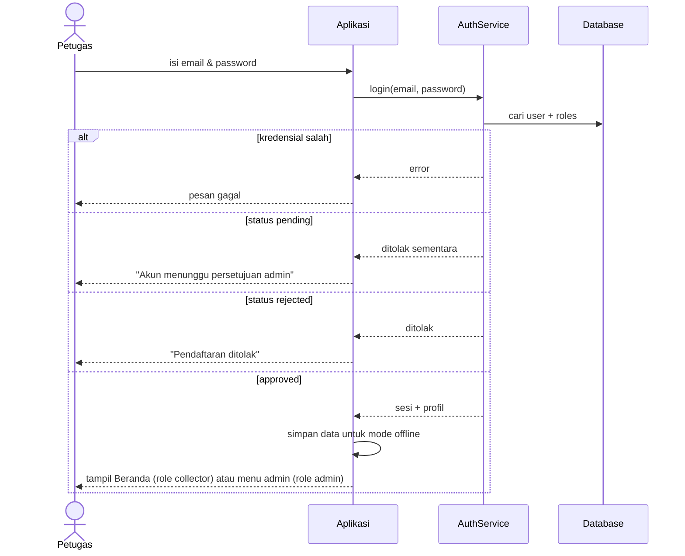

### F3 — Lupa password
⚠️ Ditunda: layar dan mekanisme reset belum ditentukan.

### F4 — Beranda dengan filter Uang dan Karung

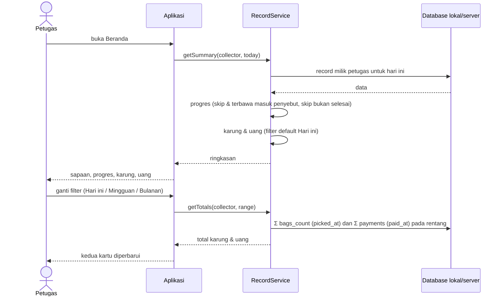
Mingguan = Senin–Minggu.

### F5 — Mulai ambil sampah (jatuh tempo + terbawa)

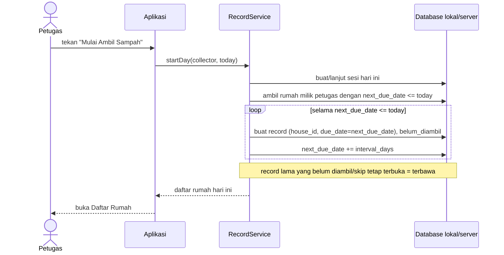

### F6 — Daftar rumah + cari

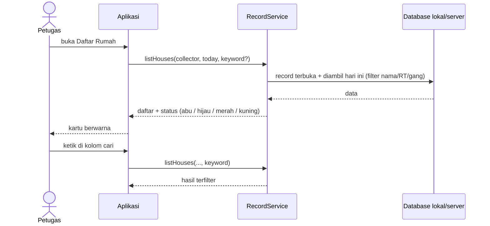

### F7 — Catat pengambilan & pembayaran (penuh / sebagian / kasbon)
⚠️ Layar belum didesain; ini usulan alur.

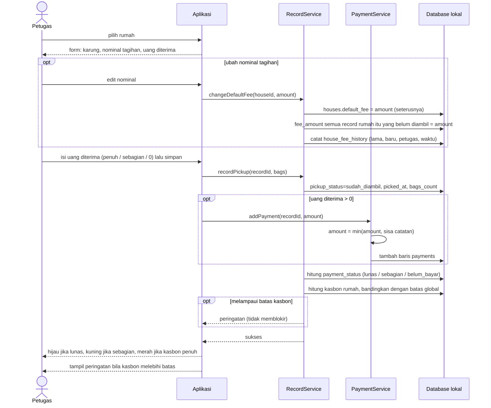

### F8 — Skip (alasan wajib) dan ubah

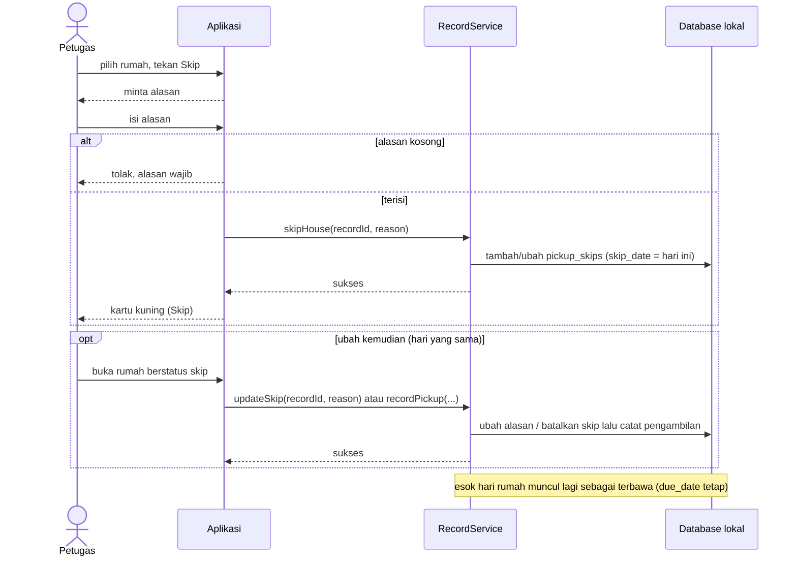

### F9 — Tambah / edit rumah, jadwal, nominal default
⚠️ Layar belum didesain.

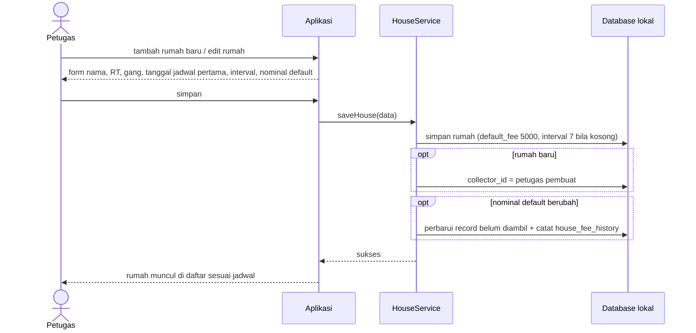
Catatan: petugas tidak bisa mengubah `collector_id` rumah yang sudah ada (hanya admin, lihat F15).

### F10 — Import data rumah dan jadwal

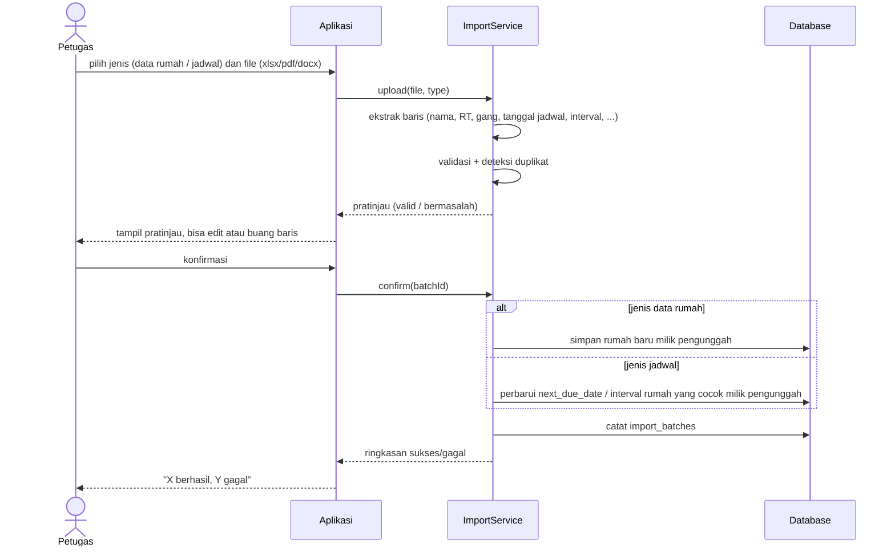
Catatan: Excel paling andal. PDF/DOCX bergantung format; **pratinjau wajib** sebelum disimpan. 💡 Sediakan template Excel standar. Satu file boleh memuat data rumah sekaligus jadwal.

### F11 — Persetujuan admin

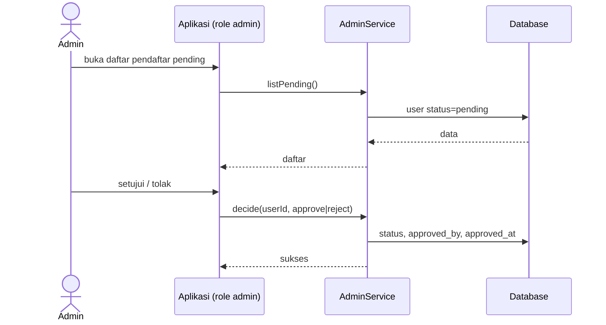

### F12 — Sinkronisasi offline

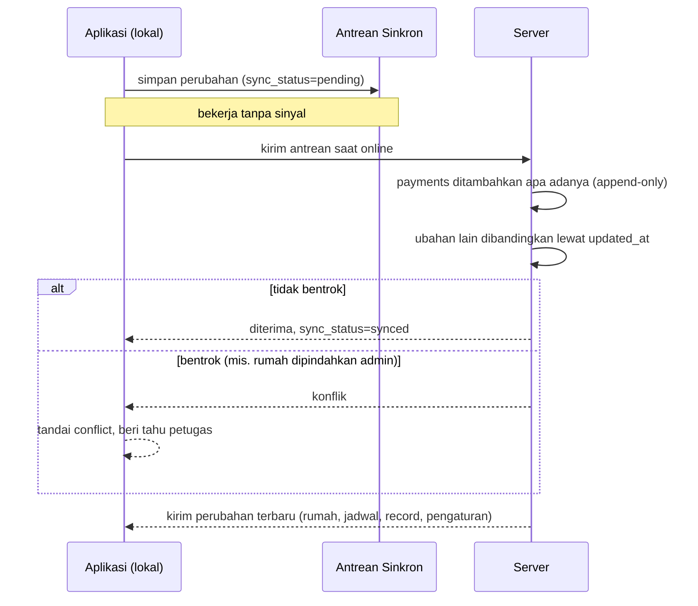

### F13 — Pelunasan kasbon (petugas memilih catatan)
⚠️ Layar belum didesain.

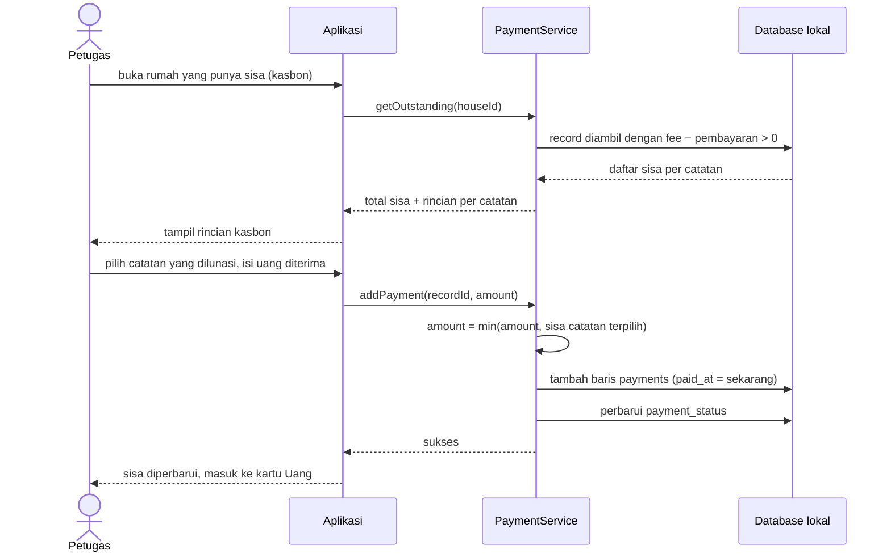
Uang diterima yang melebihi sisa catatan terpilih **dibatasi sebesar sisa**; aplikasi memberi tahu petugas jumlah yang benar-benar dicatat.

### F14 — Rekap uang
⚠️ Ditunda sampai layar ikon ke-4 didesain.

### F15 — Admin memindahkan rumah

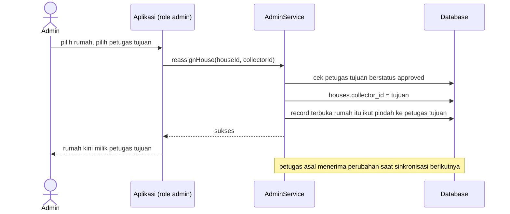
💡 Catatan terbuka ikut pindah supaya tidak tertinggal di petugas lama; catatan yang sudah diambil tetap atas nama petugas saat itu.

### F16 — Admin mengatur batas kasbon

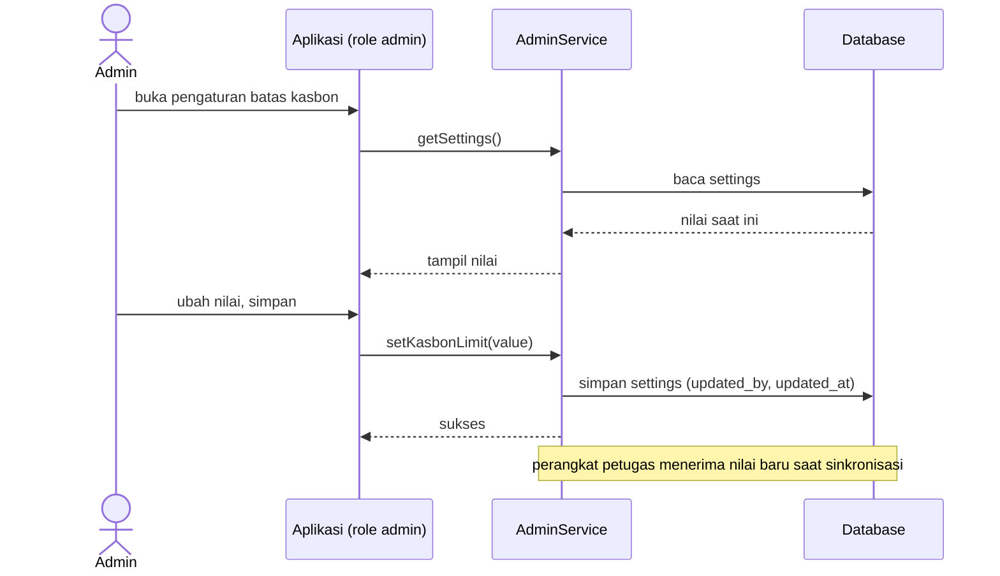

## 7. Class Diagram (keseluruhan)

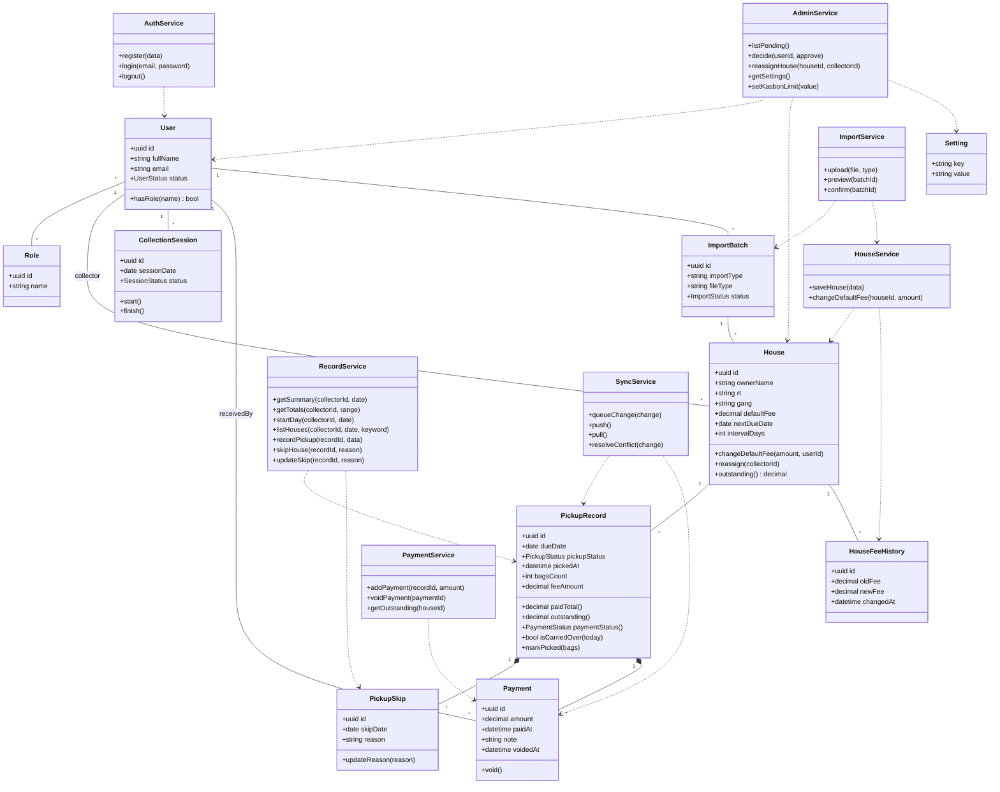

## 8. Pertanyaan Terbuka

**Admin dan akses:**
1. **Admin pertama:** bagaimana akun admin pertama dibuat? 💡 Disiapkan manual saat setup awal (seed), lalu admin berikutnya diberi role oleh admin yang sudah ada. (Admin sudah diputuskan sebagai role di aplikasi yang sama.)

**Skip dan data:**
2. **Alasan skip:** teks bebas atau pilihan baku + "lainnya"?
3. **Batas pengeditan** skip dan pembayaran: kapan saja atau dikunci setelah hari berganti? Salah input uang: setuju dikoreksi lewat pembatalan (void)?
4. **Import:** kolom apa di file sumber, termasuk kolom jadwal? Perlu **contoh file** Excel/PDF/DOCX. Duplikat rumah: lewati, timpa, atau tanya?
5. **Peringatan kasbon:** muncul saat mencatat pengambilan rumah itu (usulan saya), atau rumah berkasbon tinggi juga ditandai di daftar rumah?

**Offline:**
6. Berapa lama boleh offline, dan perlu login ulang setelah sekian hari?

**Sudah diputuskan untuk dikerjakan nanti (bukan pertanyaan terbuka):** kode warna nuansa merah Skip, serta label dan layar ikon navigasi 1, 2, 4 (mengikuti tema UI yang ada).

## 9. Langkah Berikutnya

1. Tinjau dan setujui `erd-final.md`, terutama asumsi bagian 8 (rupiah bulat, zona waktu, cache `payment_status`, dan lainnya).
2. Rancang layar yang belum ada mengikuti tema UI (form catat & bayar, kasbon, tambah/edit rumah, import, layar ikon 1, 2, 4, **layar admin**) dan perbarui Daftar Rumah di Figma.
3. Jawab pertanyaan sisa, terutama contoh file import (no. 4) karena bisa menambah kolom di `HOUSES`.
4. Pilih tech stack, lalu eksekusi kode.
